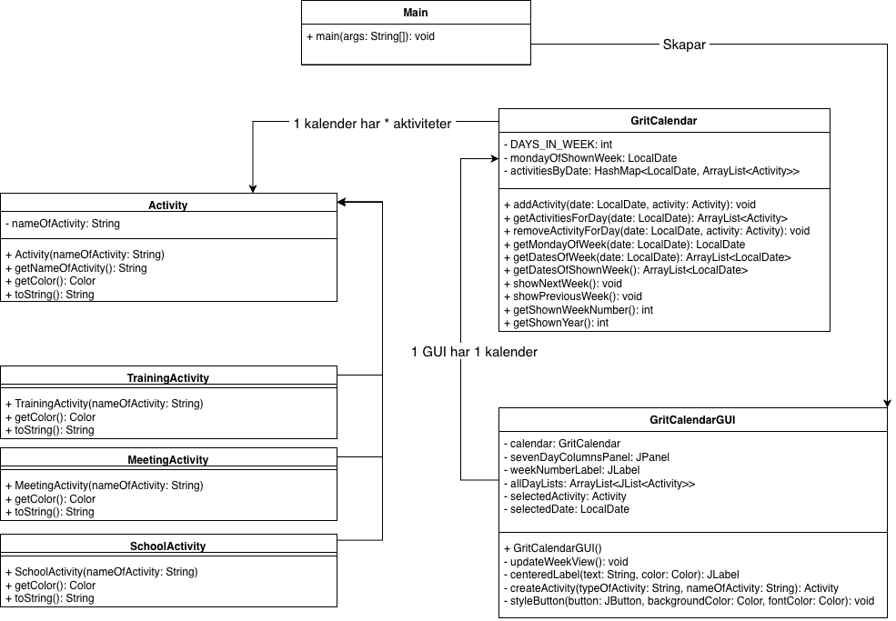

# Kalender

En veckokalender i Java och Swing.

## Starta programmet (G-R1)

Öppna projektet i IntelliJ och kör Main. JDK-version: Eclipse Temurin, JDK 25

## Klasser (G-R2)

- **Main:** Programmets start. Här ligger main som bara startar fönstret (GritCalendarGUI).
- **Activity:** En aktivitet. Den vet sitt namn och ger ut det via getNameOfActiviyu () och den vet sin färg som den ger
  ut via getColor ().
- **TrainingActivity, SchoolActivity, MeetingActivity:** Dom ärver Activity. Dom skriver över toString () så att typen
  står före namnet (t.ex. "Träning: Gym") och getColor () så att varje typ har sin egen färg.
- **GritCalendar:** Programmets hjärna. Håller koll på vilka aktiviteter som hör till vilket datum med en HashMap. Har
  metoderna för att lägga till och ta bort aktiviteter, räkna ut veckans datum, bläddra veckor och veckonummer.
- **GritCalendarGUI:** Fönstret. Visar veckan, hanterar knapparna och frågar användaren efter namn, datum och typ.
-

## Klassdiagram

## Kravtabell (G-R3)

### G: Funktionalitet

| ID   | Klass                         | Metod                                                                                                        |
|------|-------------------------------|--------------------------------------------------------------------------------------------------------------|
| G-F1 | GritCalendarGUI               | updateWeekView() bygger de sju kolumnerna, måndag till söndag                                                |
| G-F2 | GritCalendar, GritCalendarGUI | getDatesOfWeek() räknar ut datumen, updateWeekView() skriver ut dag och datum med DAY_NAME och DAY_AND_MONTH |
| G-F3 | GritCalendarGUI               | updateWeekView(), dagens kolumn får en annan färg                                                            |
| G-F4 | GritCalendar, GritCalendarGUI | addActivity(), knappen "Lägg till aktivitet" i GritCalendarGUI()                                             |
| G-F5 | GritCalendar                  | addActivity(), en ArrayList per datum i HashMapen                                                            |
| G-F6 | GritCalendar, GritCalendarGUI | removeActivityForDay(), knappen "Ta bort aktivitet" i GritCalendarGUI()                                      |
| G-F7 | GritCalendarGUI               | GritCalendarGUI(): isBlank() för tomt fält och catch (DateTimeParseException) för fel datum format           |

### G: Kod

| ID   | Klass                                   | Metod                                                                                                                          |
|------|-----------------------------------------|--------------------------------------------------------------------------------------------------------------------------------|
| G-K1 | Main                                    | main()                                                                                                                         |
| G-K2 | Activity, GritCalendar, GritCalendarGUI | Activity och GritCalendar importerar inte javax.swing                                                                          |
| G-K3 | Activity, GritCalendar, GritCalendarGUI | Alla fält är private                                                                                                           |
| G-K4 | GritCalendar                            | activitiesByDate (HashMap)                                                                                                     |
| G-K5 | GritCalendar                            | getActivitiesForDay(), getMondayOfWeek(), getDatesOfWeek()                                                                     |
| G-K6 | GritCalendarGUI                         | GritCalendarGUI(): addActionListener med lambda på knapparna                                                                   |
| G-K7 | Alla klasser                            | PascalCase på klasser, camelCase på metoder och variabler, konstanter i stora bokstäver (t.ex. DAYS_IN_WEEK och alla färgerna) |
| G-K8 | Alla klasser                            | Javadoc på varje klass och varje public metod                                                                                  |
| G-K9 | Hela projektet                          | Kompilerar och körs utan fel                                                                                                   |

### VG

| ID    | Klass                                                       | Metod                                                                                                                                                       |
|-------|-------------------------------------------------------------|-------------------------------------------------------------------------------------------------------------------------------------------------------------|
| VG-F1 | GritCalendar, GritCalendarGUI                               | Bläddra veckor: knapparna showNextWeek(), showPreviousWeek(). Veckonummer: getShownWeekNumber() och weekNumberLabel. År: getShownYear().                    |
| VG-K1 | Activity, TrainingActivity, MeetingActivity, SchoolActivity | Arv. Listan anropar toString() och getColor() på en Activity och får olika svar beroende på typen                                                           |
| VG-K2 | GritCalendarGUI                                             | catch (DateTimeParseException) med ett meddelande till användaren                                                                                           |
| VG-K3 | GritCalendarGUI                                             | styleButton(), Styr knapparnas utseende, konstanter som är använda är BUTTON_FONT som styr typsnitt, HEADER_BACKGROUND och TEXT_LIGHT för färger på knappen |
| VG-K4 | GritCalendarGUI                                             | Layouter (BorderLayout och GridLayout), ingen setBounds eller null-layout. Fönstret har en minsta storlek och följer med när man ändrar storleken           |

## Källor och hjälpmedel

- BroCode: LocalDate, https://www.youtube.com/watch?v=F2bZ1fkAQx0 Exceptions, https://www.youtube.com/watch?v=u1PROb-aRUI&list=PLZPZq0r_RZOOj_NOZYq_R2PECIMglLemc&index=57
- Oracle: How to Use Lists, https://docs.oracle.com/javase/tutorial/uiswing/components/list.html
- codejava.net: JList custom renderer example, https://codejava.net/java-se/swing/jlist-custom-renderer-example
- Skelettet till den egna ritaren för listan (JList cell renderer) fick jag hjälp med av Claude (AI).
- Jag har också använt kursmaterialet. Koden har jag skrivit själv, steg för steg, med Claude som stöd när
  jag har kört fast.

## Reflektion (VG-R1)

Jag valde att bygga GritCalendar med en HashMap. Det tyckte jag var ett bra val, eftersom jag kunde koppla ett datum
till en hel lista. Varje datum fick sin egen lista med aktiviteter. Ett annat val hade varit en enda ArrayList, men då
hade jag behövt koppla ett datum till varje aktivitet. För att visa en dag hade jag då behövt loopa igenom hela listan
och hitta alla aktiviteter för rätt datum. Med HashMap blir det smidigare, för jag kan använda HashMapens get-metod och
hämta
listan (value) som hör till datumet (key).

För att göra om det till en månadsvy hade jag behövt ändra variabeln som håller koll på måndagen i varje vecka
(getMondayOfShownWeek), så att
den i stället håller koll på första datumet i varje månad. I GUI:t hade jag i stället för en rad med 7 kolumner haft en
GridLayout med 7 kolumner och 5–6 rader, då hade jag kunnat göra kalendern i samma stil som den jag har i telefonen
(Apple kalender). Mina metoder till HashMap hade
fortfarande fungerat, eftersom jag har kopplat varje datum till en lista med aktiviteter.

Jag byggde först alla klasser och fick programmet att fungera. Efter det förbättrade jag koden. Jag delade upp
GUI-klassen i fler metoder, bland annat updateWeekView (), eftersom koden blev väldigt lång. Jag skapade också metoden
styleButton (), för annars hade jag fått upprepa samma rader på alla mina knappar.

Jag la alla magiska tal, färger och typsnitt som konstanter. Det hjälpte när jag stylade kalendern. Likt CSS slapp jag
ändra på fem ställen för att testa om något ser bättre ut.

En metod som blev liten och smidig är getDatesOfShownWeek (). Den returnerar datumen för veckan som visas, med hjälp av
getDatesOfWeek () och variabeln mondayOfShownWeek, som har värdet av måndagen i veckan som visas. Det blev bättre
eftersom jag återanvänder getDatesOfWeek () och slipper skriva samma uträkning två gånger.